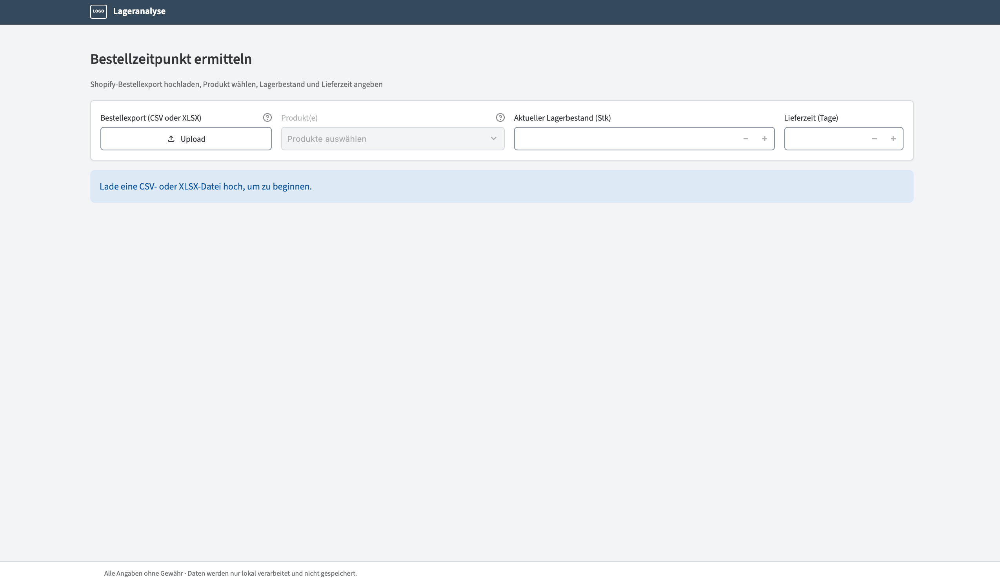
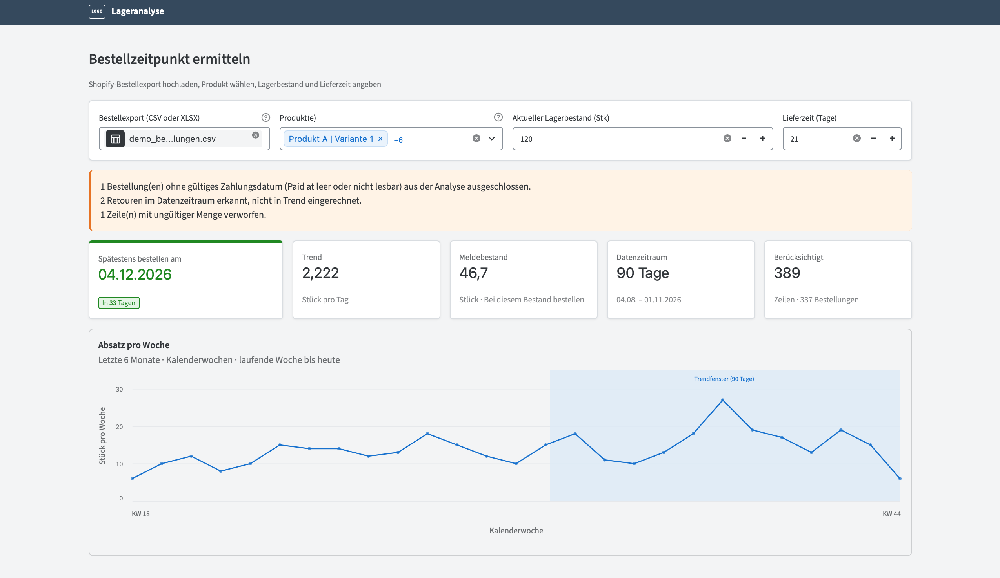
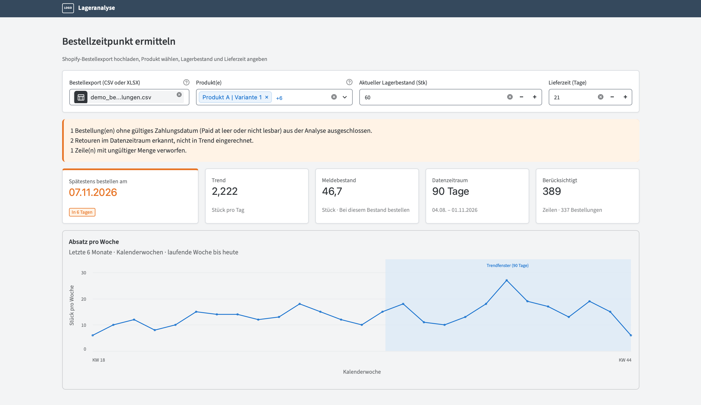
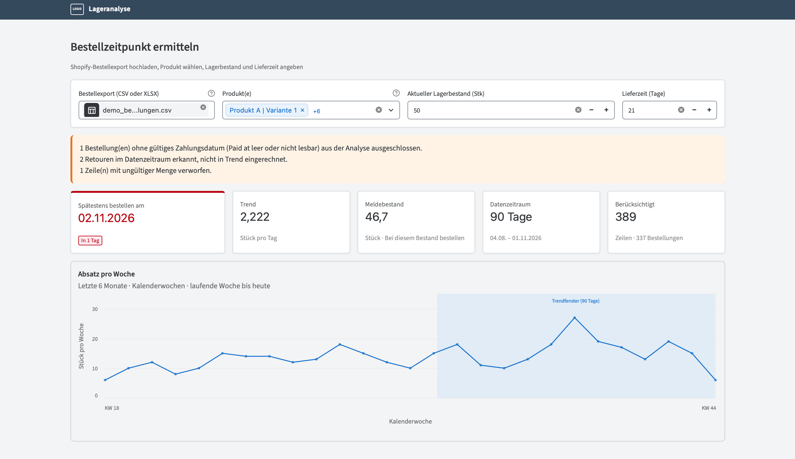
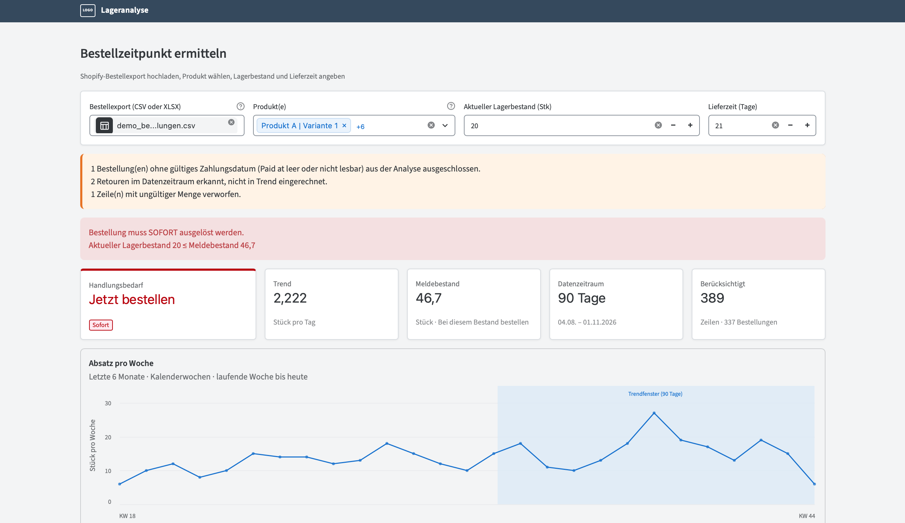

# Lageranalyse – Bestellzeitpunkt ermitteln

> 🇬🇧 [English version](README.md)

Ein kleines lokales Tool, das für einen kleinen Online-Shop eine Frage beantwortet:
**„Bis wann muss ich nachbestellen, damit mir der Bestand nicht ausgeht?“**

Du lädst einen Shopify-Bestellexport hoch, wählst ein oder mehrere Produkte und gibst
Lagerbestand und Lieferzeit an. Das Tool ermittelt aus den letzten 90 Tagen den
Absatztrend und zeigt Meldebestand und spätestes Bestelldatum.

Alles läuft auf dem eigenen Rechner: **Bestelldaten werden an keinen Dritten übertragen.**



## Funktionen

- Liest Shopify-Bestellexporte (CSV oder XLSX); genutzt werden nur vier Spalten
  (`Name`, `Paid at`, `Lineitem quantity`, `Lineitem name`)
- Mehrfachauswahl von Produkten, Mengen werden summiert
- Absatztrend der letzten 90 Tage (bis heute), Wochendiagramm der letzten 6 Monate
- Meldebestand und spätestes Bestelldatum mit Ampelstatus
- Hinweise zur Datenqualität: Retouren, Zeilen ohne Zahlungsdatum und ungültige Mengen
  werden erkannt, ausgeschlossen und angezeigt statt stillschweigend ignoriert
- Exakte Berechnung (Brüche) – keine Rundungsfehler bei den Datumsangaben

## So wird gerechnet

| Wert | Formel |
|---|---|
| Trend (Stück pro Tag) | verkaufte Stück im Fenster ÷ abgedeckte Tage (Fenster = letzte 90 Tage inkl. heute) |
| Meldebestand | Trend × Lieferzeit in Tagen |
| Tage bis zur Bestellung | ⌊(aktueller Lagerbestand − Meldebestand) ÷ Trend⌋ |
| Spätestens bestellen am | heute + Tage bis zur Bestellung |

Liegt der aktuelle Lagerbestand bereits auf oder unter dem Meldebestand, zeigt das
Tool **„Jetzt bestellen“**.

| Status | Bedingung | Farbe |
|---|---|---|
| In Ordnung | 8 oder mehr Tage | grün |
| Bald | 3 bis 7 Tage | orange |
| Dringend | 0 bis 2 Tage | rot |
| Jetzt bestellen | Bestand ≤ Meldebestand | rot, mit Hinweisleiste |

Sicherheitsbestand und Bestellmenge sind bewusst nicht Teil des Tools.
Die vollständige Spezifikation steht in
[`docs/Funktionale_Spezifikation_Lageranalyse_Tool.md`](docs/Funktionale_Spezifikation_Lageranalyse_Tool.md).

## Screenshots

Alle Bilder verwenden synthetische Demo-Daten (`sample_data/demo_bestellungen.csv`).

**Viel Zeit** (Bestand 120, Lieferzeit 21 Tage → bestellen bis 04.12.2026)



**Bald bestellen** (Bestand 60)



**Dringend** (Bestand 50) und **sofort bestellen** (Bestand 20)




## Installation und Start

Benötigt Python 3.13 (damit entwickelt und getestet).

```bash
git clone https://github.com/davidbtld/reorder-date-calculator.git
cd reorder-date-calculator

python3 -m venv .venv
source .venv/bin/activate          # Windows: .venv\Scripts\activate
pip install -r requirements.txt

streamlit run app.py
```

Die App öffnet sich unter `http://localhost:8501`. Zum Ausprobieren ohne eigene Daten
einfach `sample_data/demo_bestellungen.csv` hochladen.

Die Demodaten enden am 01.11.2026. Für ein aktuelles 90-Tage-Fenster neu erzeugen mit `python scripts/generate_demo_data.py` (das Enddatum ist standardmäßig heute).

### Tests

```bash
pip install -r requirements-dev.txt
pytest -q
```

## Projektstruktur

```
app.py            Streamlit-Einstiegspunkt (nur Verdrahtung)
config.py         Konstanten: Farben, Schwellenwerte, Trendfenster
data/             Einlesen von CSV/XLSX
core/             Fachlogik ohne UI-Code (Bereinigung, Trend, Meldebestand, ...)
ui/               Streamlit-Bausteine, Styling (theme.css), Formatierung
scripts/          Generator für die synthetischen Demo-Daten
tests/            Unit- und Pipeline-Tests
docs/             Spezifikation, Architektur-Richtlinien, erste UI-Skizze (das finale Design weicht ab, siehe Screenshots)
```

Die Schichten hängen nur nach unten voneinander ab (`data` → `core` → `ui`), daher
lässt sich die Berechnung ohne Browser testen. Details:
[`docs/Architektur_und_Code_Richtlinien.md`](docs/Architektur_und_Code_Richtlinien.md).

## Datenschutz

Dateien werden im Arbeitsspeicher auf deinem Rechner verarbeitet. Echte Exporte dürfen
nie committet werden: Die `.gitignore` schließt `*.csv`, `*.xlsx` u. Ä. aus, einzige
Ausnahme ist die synthetische Demo-Datei.

## Bekannte Einschränkungen

- Einige eingebaute Streamlit-Texte (z. B. der „Upload“-Button) sind englisch und
  lassen sich nicht sauber übersetzen.
- Die Prognose nutzt einen einfachen Durchschnittstrend – keine Saisonalität,
  kein Sicherheitsbestand.

## Ausblick

- Installierbare Desktop-App für Windows und macOS
- Automatische Testläufe über GitHub Actions

## Lizenz

[MIT](LICENSE)
