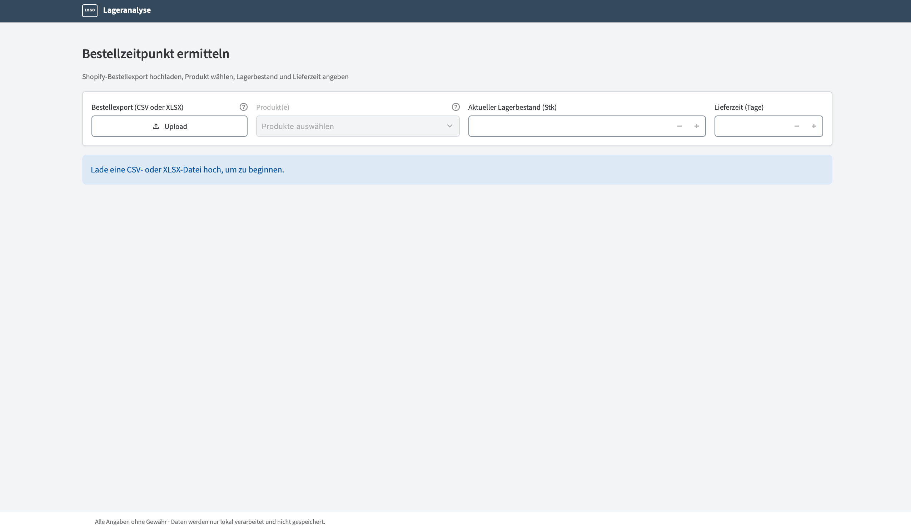
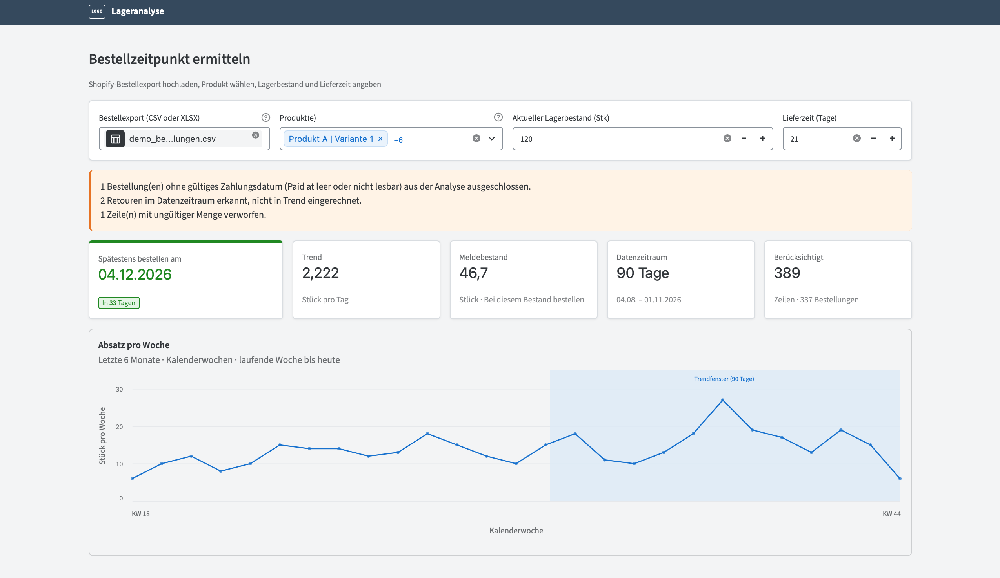
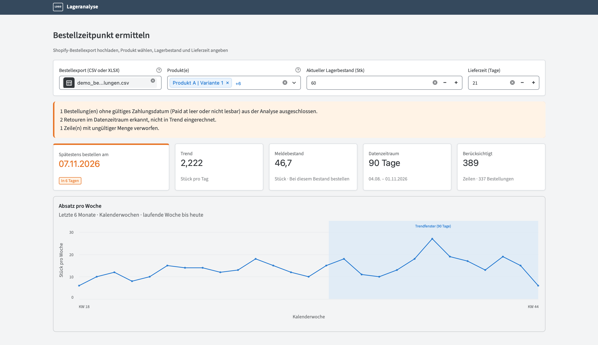
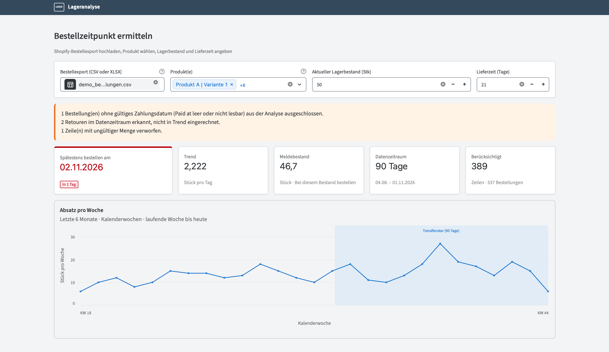
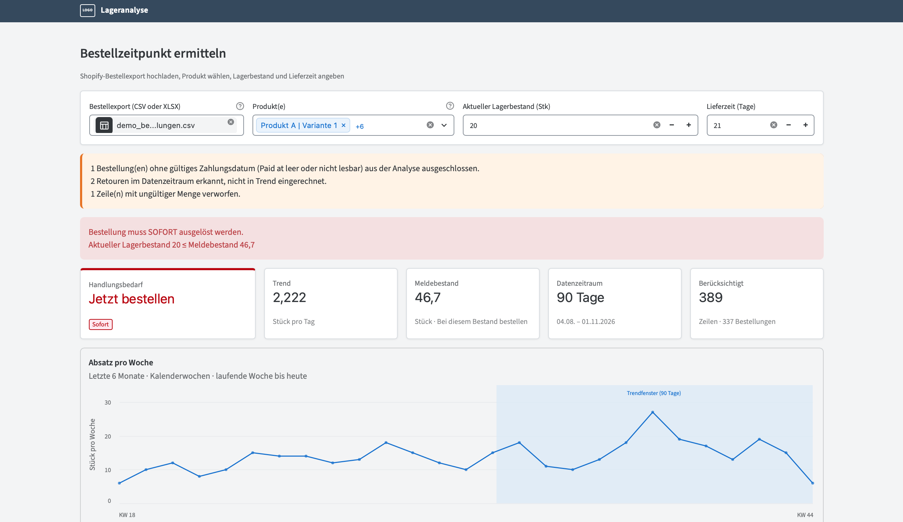

# Lageranalyse – Reorder Date Calculator

> 🇩🇪 [Deutsche Version](README.de.md)

A small local tool that answers one question for a small online shop:
**"By which date do I have to place my next order so that I don't run out of stock?"**

You upload a Shopify order export, pick one or more products, enter your current
stock and the supplier lead time. The tool derives the sales trend from the last
90 days and shows the reorder point and the latest order date.

The user interface is in German. Everything runs on your own machine:
**no order data is sent to any third party.**



## Features

- Reads Shopify order exports (CSV or XLSX); only four columns are used
  (`Name`, `Paid at`, `Lineitem quantity`, `Lineitem name`)
- Multi-select of products, quantities are summed per selection
- Sales trend over the last 90 days (ending today), weekly chart of the last 6 months
- Reorder point and latest order date with a traffic-light status
- Data-quality notes: returns, rows without a payment date and invalid quantities
  are detected, excluded and reported instead of silently ignored
- Exact arithmetic (rational numbers) – no floating-point rounding errors in the dates

## How it works

| Value | Formula |
|---|---|
| Trend (units per day) | units sold in the window ÷ covered days (window = last 90 days incl. today) |
| Reorder point (*Meldebestand*) | trend × lead time in days |
| Days until order | ⌊(current stock − reorder point) ÷ trend⌋ |
| Latest order date | today + days until order |

If the current stock is already at or below the reorder point, the tool says
**"order immediately"**.

| Status | Condition | Colour |
|---|---|---|
| OK | 8 or more days left | green |
| Soon | 3 to 7 days left | orange |
| Urgent | 0 to 2 days left | red |
| Order now | stock ≤ reorder point | red, with a banner |

Safety stock and order quantity are deliberately out of scope.
The full specification (German) is in
[`docs/Funktionale_Spezifikation_Lageranalyse_Tool.md`](docs/Funktionale_Spezifikation_Lageranalyse_Tool.md).

## Screenshots

All screenshots use synthetic demo data (`sample_data/demo_bestellungen.csv`).

**Plenty of time left** (stock 120, lead time 21 days → order by 04.12.2026)



**Order soon** (stock 60)



**Urgent** (stock 50) and **order immediately** (stock 20)




## Getting started

Requires Python 3.13 (developed and tested with this version).

```bash
git clone https://github.com/davidbtld/reorder-date-calculator.git
cd reorder-date-calculator

python3 -m venv .venv
source .venv/bin/activate          # Windows: .venv\Scripts\activate
pip install -r requirements.txt

streamlit run app.py
```

The app opens at `http://localhost:8501`. To try it without your own data, upload
`sample_data/demo_bestellungen.csv`.

The demo data ends on 2026-11-01. For a current 90-day window, regenerate it with `python scripts/generate_demo_data.py` (the end date defaults to today).

### Tests

```bash
pip install -r requirements-dev.txt
pytest -q
```

## Project structure

```
app.py            Streamlit entry point (wiring only)
config.py         Constants: colours, thresholds, trend window
data/             Reading CSV/XLSX files
core/             Business logic, no UI code (cleaning, trend, reorder, ...)
ui/               Streamlit components, styling (theme.css), formatting
scripts/          Generator for the synthetic demo data
tests/            Unit and pipeline tests
docs/             Specification, architecture guidelines, initial UI sketch (the final design differs, see screenshots)
```

The layers only depend downwards (`data` → `core` → `ui`), so the calculation can
be tested without a browser. Details: [`docs/Architektur_und_Code_Richtlinien.md`](docs/Architektur_und_Code_Richtlinien.md) (German).

## Privacy

Files are processed in memory on your computer. Real exports must never be
committed: `.gitignore` excludes `*.csv`, `*.xlsx` and similar, with the synthetic
demo file as the only exception.

## Known limitations

- A few built-in Streamlit texts (e.g. the "Upload" button) are English and cannot
  be translated cleanly.
- Forecast is a simple average trend – no seasonality, no safety stock.

## Roadmap

- Packaged desktop app for Windows and macOS
- Automated test runs on GitHub Actions

## License

[MIT](LICENSE)
